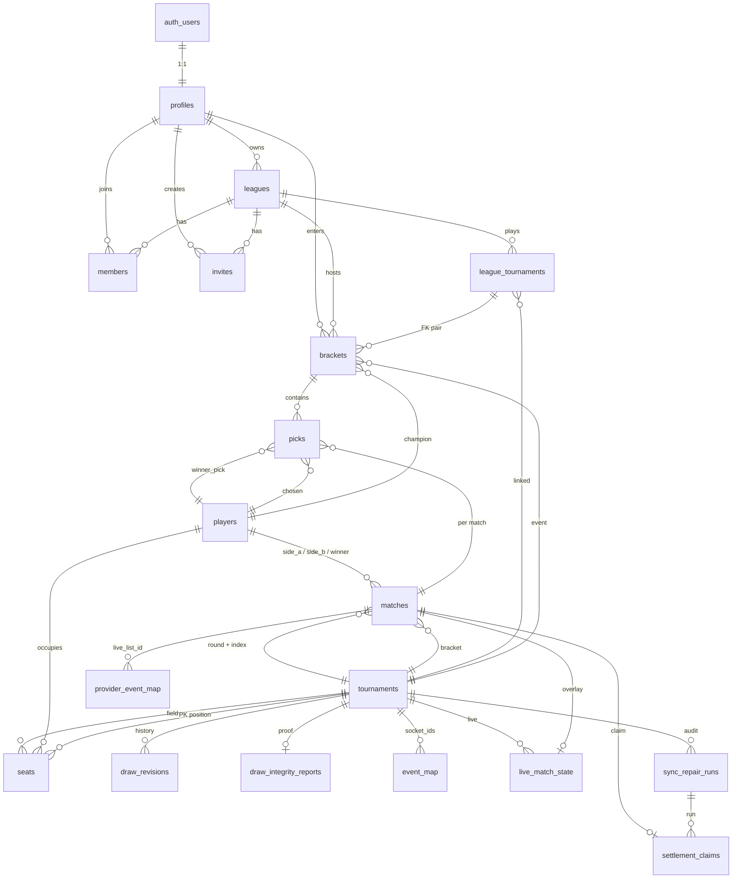

# Data model

Entity relationship for MatchRead Postgres. Schema lives in `supabase/migrations/0001`–`0023`.

Two domains share one database:

- **Facts** — tennis truth from the provider (world-readable, service-written).
- **Product** — leagues and picks (member-readable, RPC-written).

---

## Entity-relationship diagram



---

## Core entities

### Facts

| Table | Role | Key fields |
|-------|------|------------|
| `tournaments` | Calendar event + publish/lock | `slug`, `(tour, provider_id)`, `starts_on`, `main_draw_starts_on`, `draw_size`, `published_at`, `lock_at`, `tier`, `bracket_eligible`, `product_override` (`force_off` only) |
| `players` | Real people | `provider_id`, `last_name` (anti-fiction CHECKs) |
| `seats` | Official main-draw sheet | PK `(tournament_id, position)`; `kind` ∈ `player` \| `bye` \| `tbd` |
| `matches` | Topology + schedule + result | Unique `(tournament_id, round, index_in_round)` and unique `external_ref`; `has_time`, `scheduled_at`, `session` (`day` \| `night` \| null), `court`, `winner_player_id`, `voided`, `settled_at`, `official_score` (the scoreline), `fact_kind` (`played` \| `withdrawal` \| `void`) |
| `settlement_claims` | Idempotent settle boundary | PK `match_id`; `outcome` winner\|void; conflict unwinds parent advance |
| `draw_integrity_reports` | Publish proof | Must be `safe_to_publish` before official write (0017) |
| `draw_revisions` / `draw_replacements` | Draw hash history | Official field changes (`change_kind` includes `bye_to_tbd` / `tbd_to_bye`) |
| `event_map` | Pair → optional socket id | Unique `(tournament_id, pair_key)`. Fixture id is not a socket id. No socket id was captured |
| `provider_event_map` | Live-list id → match | Unique `(tour, provider_event_id)`. The same id may exist on `atp` and `wta`. `findMatchByProviderEvent` returns that match, or null when the id is unknown. `match_id` is service-role only |
| `platform_events` | Raw provider event log | One row per content hash. Payload keeps the provider row for replay and omits receipt time, tokens, and secrets. Not a live score |
| `unmapped_live_events` | Unknown live payload | Raw row that did not map. No `match_id`. Service role writes. Authenticated may read |
| `live_match_state` | Current live overlay | One row per match. `phase` is the live status. `score_text` is canonical sets. `points_text` is `0`/`15`/`30`/`40`/`AD`. `serving_side` is `a`, `b`, or null. `flag` is `live`, `provisional`, or null. `occurred_at` orders provider frames. `received_at` is local receipt. `stats` is not the raw payload |
| `listener_health` | Operator heartbeat | Id `sync-facts` keeps replay counters. Id `listener` is the latest tick: connection, last provider event, events received, mapped, unmapped, lag, token age. Founder integrity reads those tick fields. `instance_id` is the last process, not a lock. No token or secret. `live_overlay_open` is true only when that tick is `up` and newer than 90 seconds |
| `sync_repair_runs` / repairs | Ingest audit | Repair trail |

### Product

| Table | Role | Key fields |
|-------|------|------------|
| `profiles` | Display identity | 1:1 with `auth.users` |
| `leagues` | Group or solo | `format` single\|season, `is_solo`, `visibility` |
| `league_tournaments` | League ↔ event | Optional commissioner `locked_at` |
| `members` | Membership | `role` commissioner\|member |
| `invites` | Join tokens | `token`, `revoked_at` |
| `brackets` | One entry per user×league×event | `submitted_at`, `points`, `rank`, `champion_player_id` |
| `picks` | Chosen winner per match | PK `(bracket_id, match_id)` → `player_id` |

### Views / helpers

| Object | Role |
|--------|------|
| `public_calendar` | Eligible tournaments only — **public discovery surface** |
| `tournament_match_sheet` | One anon read of match facts for a draw or `/matches/[ref]`. No match uuid |
| `season_points` | Sum of bracket points for season leagues |
| `draw_is_official(id)` | `published_at` set + seat count = `draw_size` |
| `refresh_lock_at(id)` | `lock_at` = min timed R0 `scheduled_at` |
| `is_bracket_product(...)` | ATP/WTA 250+ policy (mirrored in `@matchread/core`) |

### Ops

| Table | Role |
|-------|------|
| `ops_events` | Telemetry / integrity alerts (founder dashboard) |

---

## Relationship notes

```text
auth.users ──1:1── profiles
                      │
                      ├── owns ──► leagues ◄── members ── profiles
                      │                │
                      │                ├── invites
                      │                └── league_tournaments ──► tournaments
                      │                          │
                      │                          └── brackets ──► picks ──► matches
                      │                                │              │
                      │                                └──► players   └──► players

tournaments ──*── seats ──?── players   (kind player|bye|tbd)
            ──*── matches ──?── players (sides / winner)
            ──*── settlement_claims (via matches)
```

---

## Invariants (encoded in schema / RPCs)

1. **Official draw** — seat count equals `draw_size` and `published_at` is set (`draw_is_official`).
2. **Seat kinds** — every seat is named player, official bye, or official TBD label. No fictional last names. Bye count cannot exceed the official slot-field ceiling (`N/8` on 16/32, `N/4` on 64/128); TBD is not a bye.
3. **Lock** — platform lock from timed R0 only; commissioner may lock a league event early.
4. **Picks gate** — `save_picks` / `submit_bracket` refuse when locked + official.
5. **Eligibility** — public list via `public_calendar`; override can only **force_off**, never promote.
6. **Settlement claims** — one claim per match. See [Settlement latch](#settlement-latch) for what a second official answer may change.
7. **Absence class** — A player missing from the local draw is a withdrawal only when that player is also absent from both the loaded fixture list and the loaded entry list. A player missing locally and present on either upstream list is an ingestion gap. If either list was not loaded, the absence is unexplained: it is not a withdrawal, and settlement does not run. Withdrawal is `ops_events` kind `reconcile`. An ingestion gap or unexplained absence is kind `error` (the same kind web `captureOps` uses; there is no S1 type). When the Edge secret `SENTRY_DSN` is set, sync-facts also sends that error. Those payloads carry `ref`, `slug`, `tour`, `provider_tournament_id`, and provider player ids. They do not carry the internal tournament id. `fact_kind` stays null for an archive `result_type` other than `completed` or `retired`. That check is separate from this player-absence class.
8. **Single-format leagues** — at most one tournament row (`enforce_single_league_tournament`).

---

## Settlement latch

M1 finding, from the files below. No function was changed.

### `apply_bracket_state` is not in this repository

Searched `supabase/migrations` and `supabase/migrations/archive` for `apply_bracket_state`. There is no such function.

| File the notes name | What that file actually is |
|---------------------|----------------------------|
| Live `supabase/migrations/0012_draw_revisions_event_map.sql` | Tables `draw_revisions`, `draw_replacements`, `event_map`. No function. |
| Archive `supabase/migrations/archive/0012_league_member_crud.sql` | `update_league` and member RPCs. Not a bracket writer. |

Advancement has one writer: `applyMatchResults` in `supabase/functions/_shared/apply-results.ts` → `writeWinnerIntoParent` / `healSettledAdvances`, plus the R0 bye advance inside `apply-draw`. Both call `advanceWinnerToParent` (`packages/provider-rapidapi/src/settle-advance.js`). Live socket payloads do not write seats.

### `apply_grades` is not the comparison function in this tree

The design notes describe `apply_grades` in a `0004` at a `v_settled is not null then return 0` latch. That body is not in this repository.

| File | Contents |
|------|----------|
| Live `supabase/migrations/0004_leagues.sql` | League tables. No grade function. |
| Archive `supabase/migrations/archive/0004_settlement.sql` | `match_results`, `bracket_snapshots`, `season_standings`, `pick_voids`. `settled_at` defaults to `now()` on insert. No function, so no latch and no comparison. |
| Archive `supabase/migrations/archive/0001_init.sql` | Profile stub. No `winner_side`, no `match_status`. |

The live comparison is `mergeSettledFact` in `packages/provider-rapidapi/src/normalize.js`, applied by `applyMatchResults`.

### What a second official answer can change

| Already settled? | Incoming answer | Result |
|------------------|-----------------|--------|
| No | winner, void, score, fact class | Write `matches`, then `claim_settlement` |
| Yes, same winner | missing score or `fact_kind` | Fill those columns only (`action` `fill`) |
| Yes, same winner | same score after trim | Leave the stored score (`action` `noop`) |
| Yes, same winner | different score or `fact_kind` | `ops_events` `score_conflict` / `fact_kind_conflict` when the sync run has an id; those columns stay. The skip reason is `score conflict` or `fact kind conflict` even when the run id is missing |
| Yes | different winner or void | Winner, void, score, and fact class stay. The conflict patch is empty. `ops_events` `winner_conflict` when the sync run has an id. `claim_settlement` is not called |

`applyMatchResults` returns success on that last row (`skipped` reason `winner conflict`). It does not raise. With no repair-run id, nothing is written to `ops_events` either, so the old winner is kept with no conflict row.

`applyMatchFacts` uses the same `mergeSettledFact` decision. A draw overlay cannot replace a settled winner or void.

`unwind_settlement_parent` (`supabase/migrations/0026_unwind_advanced_winner.sql`) removes the advanced player from the parent side. It reads `settlement_claims.winner_player_id` first, then the match column. A parent that already has `winner_player_id` keeps its side. `matches_unwind_advanced_winner` runs that function before any update that changes `winner_player_id`, so every writer clears the old side. `claim_settlement` still calls it when a claim is replaced, which covers a match column that was cleared first.

`writeWinnerIntoParent` writes an empty parent side. The same player is a no-op. A different player is written when the parent match has no `winner_player_id`, and left in place once that parent match has a winner. `refreshRoundZeroSides` drops the settlement claim when it replaces a mismatched round-0 winner. The trigger clears the parent side.

### Live overlay

`live_match_state` (`0027_live_match_state.sql`, clock column in `0031_live_match_state_current.sql`) is one current row per match. A later frame replaces that row. It is not an event log. `platform_events` (`0040_platform_events.sql`) is that log: one row per content hash of the raw provider payload. Receipt time is not part of the hash. A repeat is not inserted and is not projected again. The listener drops that same row first with `equalForIngest`. `upsert_live_match_state` returns `duplicate` for the same frame and does not write `matches`. Token and secret fields are not stored. There is no `live_events` table. An unmapped raw payload, including a row whose tournament this product does not carry, is also `unmapped_live_events`. That not-carried archive does not insert `ops_events`. A structured note is `ops_events`.

Reads are by `match_id` (primary key) or `public_ref` (unique). A tournament filter uses `live_match_state_tournament_phase_idx` on `(tournament_id, phase)`. `live_match_state_flag_idx` is `(flag, tournament_id)` where `flag` is not null, so `flag = 'live'` and a set flag share that index. There is no `status` column and no second index only for `flag = 'live'`. The earlier tournament-only index is dropped.

`anon` and `authenticated` may select every live row. They have no insert, update, delete, or truncate grant, and there is no write policy. `service_role` bypasses row security and holds those writes. `upsert_live_match_state` is `security definer` and executable by `service_role` only. The web snapshot uses the anon key inside `getLiveTournamentState` (`apps/web/server/repositories/live.ts`). The argument is the public tournament slug. The JSON is canonical live display for the matches in that event. It does not return `match_id`, `tournament_id`, or provider payload fields.

`live_match_state` is in the one publication `supabase_realtime`, with replica identity full, so the server-side Postgres Changes filter can see `tournament_id`. The client delete record is the primary key. There is no publication per tournament. `useLiveTournament` subscribes once per public tournament ref on the topic `live:tournament:{ref}`, with the filter `tournament_id=eq.<id>`. Match cells on that event share the topic. Unmount calls `removeChannel` on that topic.

Live status is `phase` (`in_play`, `suspended`, `provisional_final`). `score_text` stores canonical `N-N` sets, not the provider field name, read from side a: when the provider's first player (`matchId` segment 1) is the match's side b, sets and game are swapped before storing. A first player that is not one of the sides keeps the provider order. `points_text` stores the current game as the strings `0`, `15`, `30`, `40`, and `AD`. `AD` is not an integer. Any other `points` text, including a duplicated set such as `5-2`, is stored null. Captured rows have no tie-break point field, so a `7-6` or `6-7` set stays in `score_text`. `serving_side` is `a`, `b`, or null. It is set only when the two provider player ids resolve to different sides and the serving id is exactly one of them. A missing provider player does not drop the score when the match is already identified, and the serve stays null. The provider indicator is not a server. The public cell shows a serve mark only for `a` or `b`. A null side shows none. Game counts are not a server. `flag` is `live` or `provisional` from that phase, or null. Eligibility is not derived. Break point and match point are a separate derivation from the canonical score. They are null when the format, the game, the side order, or a required server is missing. A duplicated `5-2`, a parenthetical tie-break, a spaced set list, or a `6-6` set does not create one. They are not stored in `flag` and they are not a provider label. `provisional_winner_ref` is the only winner on a live row. The normalizer sets it from a terminal frame. It is not `winner_side` and the live upsert does not write `matches.winner_player_id`. `occurred_at` is provider `updatedAt` and is the order for that sequence source. A numeric `updatedAt` is epoch milliseconds. `startTimestamp` is not that clock. `received_at` is when MatchRead received the frame. `stats` stays null unless a later thin fact is added; it cannot hold the raw payload. Every raw provider row is `platform_events`. An unmapped copy also stays in `unmapped_live_events`.

The public bracket cell is addressable by `matches.external_ref` (`data-public-ref` and `data-base-resolution`). Announced pairs use the same attributes. `liveNodePatch` (`apps/web/lib/live/node-patch.ts`) is the canonical patch for that ref. It does not carry `match_id` or `tournament_id`. `patchAffectedNodes` updates only the nodes with that ref. A live score, serve mark, or provisional final patches that cell. `matches` has no status column, so `officialMatchPatch` is null and live ingestion does not set `status = 'live'`. It does not write `matches` at all: not `winner_player_id`, `official_score`, a scoreline, a parent side, `winner_side`, or a bracket outcome. A provisional winner stays on `live_match_state.provisional_winner_ref`. Advancement stays on `applyMatchResults` / `apply-draw` after `mergeSettledFact`. Live code does not call `settleAll`, `apply_grades`, or `apply_bracket_state`. `gradeBracket` takes `Authoritative<OfficialResults>`. `LiveOnly<OfficialResults>` is not assignable to that parameter. There is no cast from a live value to `OfficialResult`.

`provisional_winner_ref` on the live row is a player ref from a terminal frame whose winner id matches a side. It is cleared by deleting that live row after an official settle has been written. `clearsProvisionalLive` is true for `write`, `fill`, and `noop`, so a later REST confirmation of the same winner deletes the row again. A winner conflict does not:

| Writer | Where |
|--------|--------|
| `applyMatchResults` | `supabase/functions/_shared/apply-results.ts`, after `writeWinnerIntoParent` on `mergeSettledFact` `action` `write`, `fill`, or `noop` |
| R0 bye settle | `refreshRoundZeroSides` in `supabase/functions/_shared/apply-draw.ts`, immediately after the `matches` update that sets the bye winner |

Both call `clearProvisionalLive` through `releaseProvisionalLive`. The results path advances the parent first, then deletes the live row, so the sheet can show the official winner and the next seat together. Before the delete, a live score or provisional winner that differs from the official score or winner ref is inserted as `ops_events` `name = 'live_rest_disagreement'`, `kind = 'reconcile'`. A comma and a space in the score are the same fact. The payload keeps both original strings and both winner refs. A failed insert leaves the live row in place and fails the results apply. The official row stays. A `winner conflict` keeps the stored official winner, records that same disagreement against the stored winner and score, and does not delete the live row. A later `fill` of a null score does not replace that winner, and that confirmation still deletes the live row after the disagreement is stored. Live and socket code are not the clearer. A frame for a match that is already official is ignored, and the same disagreement row is returned when that frame's score or winner ref differs. A failed insert fails the live request. `replay:live --write` inserts those rows and exits if the insert fails. It does not update `matches`.

`upsert_live_match_state` replaces that row only when the incoming `occurred_at` is later than the stored one. Equal `occurred_at` is a no-op: a later `received_at` does not replace that frame. An earlier clock is a no-op as well. `ingestLiveFrames` does not read the stored live row before projecting a batch, so a later batch that holds only an older clock still calls the upsert. The stored row stays. A sheet refetch paints that row, so the cell does not roll backward. Captured live rows have `updatedAt` and no `seq`, so an equal clock has no second provider sequence. Receipt time is stored on an accepted frame and is not the order. A replay cursor still orders frames that have no provider clock. The cell stores that clock and does not paint an equal or earlier one.

A `provisional_final` row whose `updated_at` is older than 24 hours is deleted by `sweep_terminal_live_state`. `in_play` and `suspended` stay. The delete does not write `matches`. `invoke_sync_facts` calls that function on the existing `sync-facts-5m` job, before the Edge POST, including when Vault secrets are unset. `sync-facts` calls it again unless the body is a dry run. There is no second cron job.

### M4

A later Ceiling pass that reads only `matches.winner_player_id` will use the first settled winner. It needs its own settled-conflict branch: a later official winner or void that differs is not applied here, and it is not an exception. The signal, when a repair run id exists, is `ops_events.name = 'winner_conflict'`.

---

## Migration map (themes)

| Migration | Theme |
|-----------|--------|
| 0001 | Profiles |
| 0002 | Tournaments, players, seats |
| 0003 | Matches + `refresh_lock_at` |
| 0004 | Leagues, members, invites |
| 0005 | Brackets, picks, season_points |
| 0006 | RLS + product RPCs |
| 0007–0009 | Cron → Edge |
| 0010–0011 | Calendar identity / solo naming |
| 0012 | Draw revisions, event_map |
| 0013 | Trust boundary, ops_events, tier |
| 0014 | `main_draw_starts_on` |
| 0015 | Settlement claims |
| 0016 | Eligibility + `public_calendar` |
| 0017 | Lock write / publish integrity proof |
| 0018 | Restore main-draw dates |
| 0019 | Publish trigger eligibility |
| 0020 | Clear one misclassified draw |
| 0021 | `bye_to_tbd` replacement kind |
| 0022 | `matches.official_score` + `fact_kind` |
| 0023 | `external_ref`, `session`, `court`; `tournament_match_sheet` |
| 0024 | `matches.session` is `day`, `night`, or null |
| 0025 | UTC midnight is not `has_time`. There is no `starts_at` |
| 0027 | `live_match_state`, `listener_health`. Live is not settlement |
| 0028 | `upsert_live_match_state` writes the live row only when the sequence is newer and the source matches. Its `provider_event_map` view is replaced by 0029 |
| 0029 | Table `provider_event_map`: unique `(tour, provider_event_id)`, index on `match_id`. Anon has no read. Authenticated may read the provider key, not `match_id`. Writes are service_role |
| 0030 | `unmapped_live_events` stores the raw live payload when a frame does not map. The table has no `match_id` |
| 0031 | `live_match_state.occurred_at` is provider `updatedAt`. The row stays one current projection per match |
| 0032 | Live semantics: canonical sets and game strings, derived `flag`, `received_at`, thin `stats`. Receipt does not override provider order |
| 0033 | `live_match_state` indexes: `(tournament_id, phase)` and a partial index where `flag` is not null. The tournament-only index is dropped |
| 0034 | Live scores are public reads. `anon` and `authenticated` cannot write `live_match_state`. Writes are `service_role` |
| 0035 | `live_match_state` is in `supabase_realtime`. Replica identity is full. One publication for every tournament |
| 0036 | `sweep_terminal_live_state` deletes `provisional_final` rows older than 24 hours. `invoke_sync_facts` calls it. No new cron job |
| 0037 | `upsert_live_match_state` applies a frame only when `occurred_at` is newer. An equal or earlier clock is a no-op |
| 0038 | `listener_health.instance_id` records the last listener process. It is not a lock |
| 0039 | `listener_health` latest-tick columns: events received, mapped, unmapped, lag, token age, last heartbeat. Row id `listener` |
| 0040 | `platform_events`. Raw provider payload, unique on content hash. No `live_events` table |
| 0041 | `live_overlay_open` is true when the listener tick is up and newer than 90 seconds. It does not read `matches` |

Archive SQL under `supabase/migrations/archive/` is historical, not the live chain. There is no `apply_bracket_state` function in the live chain or the archive.
