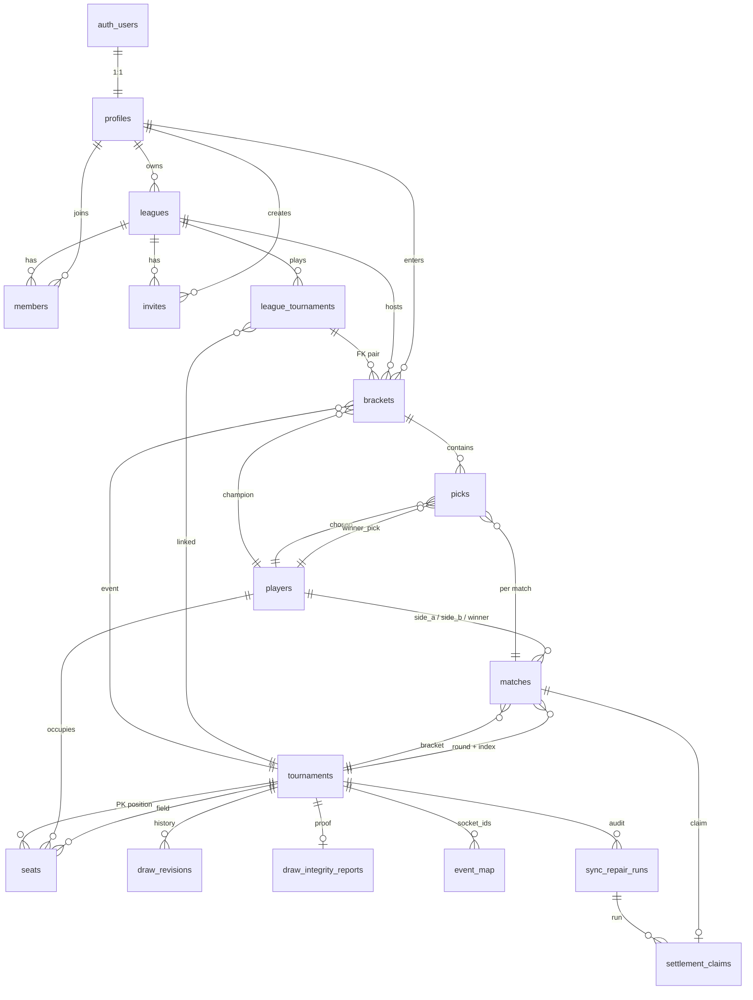

# Data model

Entity relationship for MatchRead Postgres. Schema lives in `supabase/migrations/0001`–`0022`.

Two domains share one database:

- **Facts** — tennis truth from the provider (world-readable, service-written).
- **Product** — leagues and picks (member-readable, RPC-written).

---

## Entity-relationship diagram



---

## Core entities

### Facts

| Table | Role | Key fields |
|-------|------|------------|
| `tournaments` | Calendar event + publish/lock | `slug`, `(tour, provider_id)`, `starts_on`, `main_draw_starts_on`, `draw_size`, `published_at`, `lock_at`, `tier`, `bracket_eligible`, `product_override` (`force_off` only) |
| `players` | Real people | `provider_id`, `last_name` (anti-fiction CHECKs) |
| `seats` | Official main-draw sheet | PK `(tournament_id, position)`; `kind` ∈ `player` \| `bye` \| `tbd` |
| `matches` | Topology + schedule + result | Unique `(tournament_id, round, index_in_round)`; `has_time`, `scheduled_at`, `winner_player_id`, `voided`, `settled_at`, `official_score` (the scoreline), `fact_kind` (`played` \| `withdrawal` \| `void`) |
| `settlement_claims` | Idempotent settle boundary | PK `match_id`; `outcome` winner\|void; conflict unwinds parent advance |
| `draw_integrity_reports` | Publish proof | Must be `safe_to_publish` before official write (0017) |
| `draw_revisions` / `draw_replacements` | Draw hash history | Official field changes (`change_kind` includes `bye_to_tbd` / `tbd_to_bye`) |
| `event_map` | Live socket ↔ match | Provider live event binding |
| `sync_repair_runs` / repairs | Ingest audit | Repair trail |

### Product

| Table | Role | Key fields |
|-------|------|------------|
| `profiles` | Display identity | 1:1 with `auth.users` |
| `leagues` | Group or solo | `format` single\|season, `is_solo`, `visibility` |
| `league_tournaments` | League ↔ event | Optional commissioner `locked_at` |
| `members` | Membership | `role` commissioner\|member |
| `invites` | Join tokens | `token`, `revoked_at` |
| `brackets` | One entry per user×league×event | `submitted_at`, `points`, `rank`, `champion_player_id` |
| `picks` | Chosen winner per match | PK `(bracket_id, match_id)` → `player_id` |

### Views / helpers

| Object | Role |
|--------|------|
| `public_calendar` | Eligible tournaments only — **public discovery surface** |
| `season_points` | Sum of bracket points for season leagues |
| `draw_is_official(id)` | `published_at` set + seat count = `draw_size` |
| `refresh_lock_at(id)` | `lock_at` = min timed R0 `scheduled_at` |
| `is_bracket_product(...)` | ATP/WTA 250+ policy (mirrored in `@matchread/core`) |

### Ops

| Table | Role |
|-------|------|
| `ops_events` | Telemetry / integrity alerts (founder dashboard) |

---

## Relationship notes

```text
auth.users ──1:1── profiles
                      │
                      ├── owns ──► leagues ◄── members ── profiles
                      │                │
                      │                ├── invites
                      │                └── league_tournaments ──► tournaments
                      │                          │
                      │                          └── brackets ──► picks ──► matches
                      │                                │              │
                      │                                └──► players   └──► players

tournaments ──*── seats ──?── players   (kind player|bye|tbd)
            ──*── matches ──?── players (sides / winner)
            ──*── settlement_claims (via matches)
```

---

## Invariants (encoded in schema / RPCs)

1. **Official draw** — seat count equals `draw_size` and `published_at` is set (`draw_is_official`).
2. **Seat kinds** — every seat is named player, official bye, or official TBD label. No fictional last names. Bye count cannot exceed the official slot-field ceiling (`N/8` on 16/32, `N/4` on 64/128); TBD is not a bye.
3. **Lock** — platform lock from timed R0 only; commissioner may lock a league event early.
4. **Picks gate** — `save_picks` / `submit_bracket` refuse when locked + official.
5. **Eligibility** — public list via `public_calendar`; override can only **force_off**, never promote.
6. **Settlement claims** — one claim per match. See [Settlement latch](#settlement-latch) for what a second official answer may change.
7. **Absence class** — A player missing from the local draw is a withdrawal only when that player is also absent from both the loaded fixture list and the loaded entry list. A player missing locally and present on either upstream list is an ingestion gap. If either list was not loaded, the absence is unexplained: it is not a withdrawal, and settlement does not run. Withdrawal is `ops_events` kind `reconcile`. An ingestion gap or unexplained absence is kind `error` (the same kind web `captureOps` uses; there is no S1 type). When the Edge secret `SENTRY_DSN` is set, sync-facts also sends that error. Those payloads carry `ref`, `slug`, `tour`, `provider_tournament_id`, and provider player ids. They do not carry the internal tournament id. `fact_kind = withdrawal` remains the published class of a bound walkover, default, or withdrawal result and is separate from this player-absence check.
8. **Single-format leagues** — at most one tournament row (`enforce_single_league_tournament`).

---

## Settlement latch

M1 finding, from the files below. No function was changed.

### `apply_bracket_state` is not in this repository

Searched `supabase/migrations` and `supabase/migrations/archive` for `apply_bracket_state`. There is no such function.

| File the notes name | What that file actually is |
|---------------------|----------------------------|
| Live `supabase/migrations/0012_draw_revisions_event_map.sql` | Tables `draw_revisions`, `draw_replacements`, `event_map`. No function. |
| Archive `supabase/migrations/archive/0012_league_member_crud.sql` | `update_league` and member RPCs. Not a bracket writer. |

Advancement has one writer: `applyMatchResults` in `supabase/functions/_shared/apply-results.ts` → `writeWinnerIntoParent` / `healSettledAdvances`, plus the R0 bye advance inside `apply-draw`. Both call `advanceWinnerToParent` (`packages/provider-rapidapi/src/settle-advance.js`). Live socket payloads do not write seats.

### `apply_grades` is not the comparison function in this tree

The design notes describe `apply_grades` in a `0004` at a `v_settled is not null then return 0` latch. That body is not in this repository.

| File | Contents |
|------|----------|
| Live `supabase/migrations/0004_leagues.sql` | League tables. No grade function. |
| Archive `supabase/migrations/archive/0004_settlement.sql` | `match_results`, `bracket_snapshots`, `season_standings`, `pick_voids`. `settled_at` defaults to `now()` on insert. No function, so no latch and no comparison. |
| Archive `supabase/migrations/archive/0001_init.sql` | Profile stub. No `winner_side`, no `match_status`. |

The live comparison is `mergeSettledFact` in `packages/provider-rapidapi/src/normalize.js`, applied by `applyMatchResults`.

### What a second official answer can change

| Already settled? | Incoming answer | Result |
|------------------|-----------------|--------|
| No | winner, void, score, fact class | Write `matches`, then `claim_settlement` |
| Yes, same winner | missing score or `fact_kind` | Fill those columns only (`action` `fill`) |
| Yes, same winner | same score after trim | Leave the stored score (`action` `noop`) |
| Yes, same winner | different score or `fact_kind` | `ops_events` `score_conflict` / `fact_kind_conflict` when the sync run has an id; those columns stay. The skip reason is `score conflict` or `fact kind conflict` even when the run id is missing |
| Yes | different winner or void | Winner and void stay. `ops_events` `winner_conflict` when the sync run has an id. `claim_settlement` is not called |

`applyMatchResults` returns success on that last row (`skipped` reason `winner conflict`). It does not raise. With no repair-run id, nothing is written to `ops_events` either, so the old winner is kept with no conflict row.

A winner conflict can still fill a null `official_score` or `fact_kind`. `mergeSettledFact` puts those fills on the patch before it returns `action: "conflict"`, and `applyMatchResults` writes any non-empty patch before it skips the winner.

`claim_settlement` (`supabase/migrations/0015_settlement_claims.sql`) is not that latch. The same outcome returns `noop`. A different outcome calls `unwind_settlement_parent` and updates the claim (`replaced`). `applyMatchResults` calls it only on the first write (`action` `write`). A later different winner never reaches `replaced`.

`writeWinnerIntoParent` writes an empty parent side. The same player is a no-op. A different player is written when the parent match has no `winner_player_id`, and left in place once that parent match has a winner.

### M3 provisional winner — deferred

`provisional_winner` and `live_match_state` are not on this branch. No migration, column, or type defines them. M1 does not add either.

When M3 stores a provisional winner, clear it only after an official settle has been written:

| Writer | Where |
|--------|--------|
| `applyMatchResults` | `supabase/functions/_shared/apply-results.ts`, immediately after the `matches` update that follows `mergeSettledFact` `action` `write` |
| R0 bye settle | `refreshRoundZeroSides` in `supabase/functions/_shared/apply-draw.ts`, immediately after the `matches` update that sets the bye winner |

Do not clear it when `action` is `conflict` (`winner conflict`): the stored official winner stayed. A later `fill` of a null score does not replace that winner. Live and socket code are not the clearer.

### M4

A later Ceiling pass that reads only `matches.winner_player_id` will use the first settled winner. It needs its own settled-conflict branch: a later official winner or void that differs is not applied here, and it is not an exception. The signal, when a repair run id exists, is `ops_events.name = 'winner_conflict'`.

---

## Migration map (themes)

| Migration | Theme |
|-----------|--------|
| 0001 | Profiles |
| 0002 | Tournaments, players, seats |
| 0003 | Matches + `refresh_lock_at` |
| 0004 | Leagues, members, invites |
| 0005 | Brackets, picks, season_points |
| 0006 | RLS + product RPCs |
| 0007–0009 | Cron → Edge |
| 0010–0011 | Calendar identity / solo naming |
| 0012 | Draw revisions, event_map |
| 0013 | Trust boundary, ops_events, tier |
| 0014 | `main_draw_starts_on` |
| 0015 | Settlement claims |
| 0016 | Eligibility + `public_calendar` |
| 0017 | Lock write / publish integrity proof |
| 0018 | Restore main-draw dates |
| 0019 | Publish trigger eligibility |
| 0020 | Clear one misclassified draw |
| 0021 | `bye_to_tbd` replacement kind |
| 0022 | `matches.official_score` + `fact_kind` |

Archive SQL under `supabase/migrations/archive/` is historical, not the live chain. There is no `apply_bracket_state` function in the live chain or the archive.
